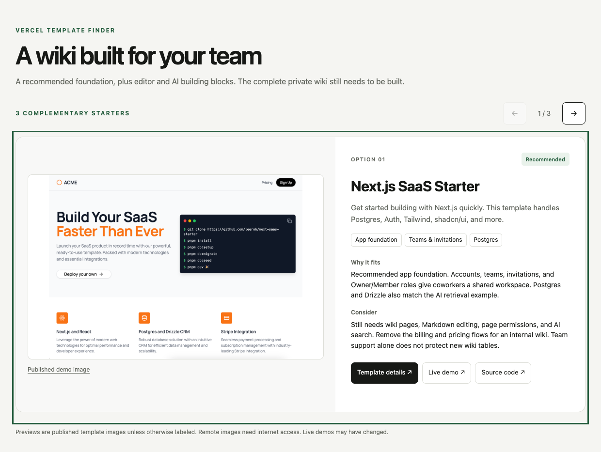

# Vercel Template Finder

An agent skill for finding and comparing Vercel starter templates. It can search the live gallery without requiring the optional local catalog, explain each choice in plain language, and generate an accessible carousel with published template previews and demo links.

The carousel helper uses Python's standard library. It can fetch metadata for selected official Vercel template pages and writes a standalone HTML carousel plus a JSON manifest. It does not deploy templates or install project dependencies.

## The local preview app

The skill creates a small, self-contained web page for reviewing a shortlist. It uses the templates' published preview images and gives each option its own card with your notes on why it fits, what to consider, and links to the official template page, live demo, and source code. The screenshot below shows a real carousel generated for a coworker wiki shortlist; the cards are template previews, not AI-made product mockups.



This makes a recommendation easier to judge than a list of names: you can see the actual starters, move between them with the buttons or keyboard, swipe on a phone, and open a demo or repository from the same card. Each card keeps its tradeoffs alongside the preview, so a polished screenshot does not stand in for checking the feature fit. The layout works on mobile and desktop, and shows a clear fallback if an image is unavailable.

The generated page runs in your browser from a local HTML file; it needs no web framework, build step, or local server. With `--enrich`, the helper reads metadata from only the selected Vercel template pages. The HTML links to public preview images, which load from their original hosts and therefore require an internet connection. A published template preview may be a screenshot or social image; it is not proof that the live demo currently works.

## Install with skills CLI

```bash
npx skills add Leonb830/vercel-template-finder --skill vercel-template-finder
```

The skill is located at `skills/vercel-template-finder/`.

## Generate a carousel

Prepare a UTF-8 JSON array of selected templates, each with an official Vercel template `detail_url`, then run:

```bash
python3 skills/vercel-template-finder/scripts/create_carousel.py \
  --input selected-templates.json \
  --output template-carousel.html \
  --title "Templates for your project" \
  --enrich
```

`--enrich` reads metadata from the selected Vercel detail pages to discover published preview images and demo links. Images load from their public hosts in the browser. See the skill's `SKILL.md` for input fields, workflow, and limitations.

Open `template-carousel.html` in a browser to use the generated page. The companion JSON manifest records each image and link source, retrieval time, and any metadata errors.

## Based on

This skill builds on the open-source [Vercel Templates Discovery](https://github.com/imKXNNY/vercel-templates-discovery) project and its MIT-licensed skill. This repository adapts the workflow and adds a local preview-carousel generator; it is not affiliated with Vercel.
